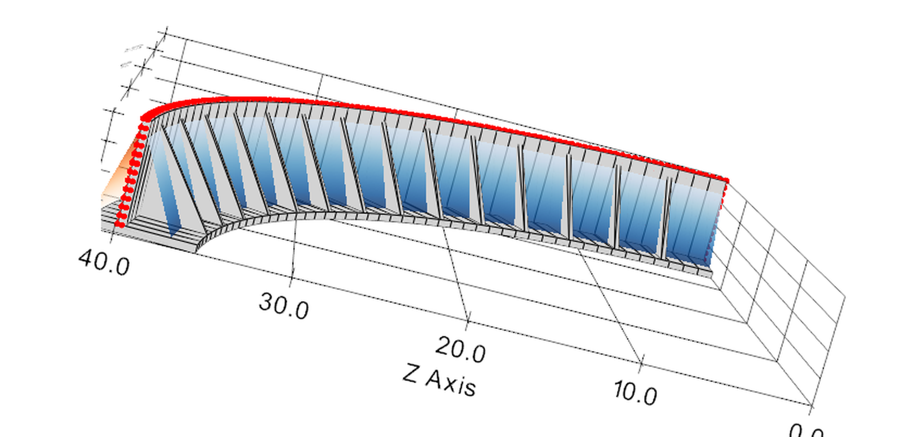

# Curved Retaining Wall Generator for STAAD.Pro

## Overview

Curved retaining walls are difficult to model by hand in STAAD.Pro. The engineer has to:

- Build a curved wall surface from plate (shell) elements
- Apply water pressure and earth pressure, both of which vary with depth
- Represent the soil behind or below the wall, which can push on the wall but cannot pull it

Doing this manually is slow and easy to get wrong, especially when the radius, height or soil data changes.

This tool automates the whole process. You enter the wall geometry, soil properties and water level in a desktop interface (GUI), preview the wall in 3D, and then generate the model directly in STAAD.Pro through **OpenStaadPy**.



## Key Features

- **Desktop interface** built with PySide6
- **Interactive 3D preview** of the curved wall mesh using PyVista, before anything is sent to STAAD.Pro
- **Curved wall profile** generated as STAAD.Pro plate (shell) elements
- **Water and earth pressure** applied as loads that vary with depth
- **Soil–structure interaction** modelled with compression-only members, so the soil supports the wall in compression only
- **Direct model creation in STAAD.Pro** through the OpenStaadPy library

## Workflow

1. Open STAAD.Pro and create or open a blank model.
2. Run the Python script.
3. Enter the wall geometry, soil properties and water level in the GUI.
4. Check the wall in the 3D PyVista preview.
5. Click **Generate** to create nodes, plates, supports and loads in STAAD.Pro.
6. Run the analysis in STAAD.Pro and review the results.

## Requirements

- Windows
- STAAD.Pro with OpenSTAAD available (Python bitness must match STAAD.Pro, normally 64-bit)
- Python 3.x
- Python libraries listed in `requirements.txt`

## Installation

```bash
python -m pip install -r requirements.txt
```

## How to Run

1. Start STAAD.Pro and open a model.
2. Run:

```bash
python curved_fe_retaining_wall_generator.py
```

## Troubleshooting

| Error | Fix |
|---|---|
| `No module named 'PySide6'` | `python -m pip install PySide6` |
| `No module named 'pyvista'` | `python -m pip install pyvista pyvistaqt` |
| Cannot connect to STAAD.Pro | Open STAAD.Pro with a model loaded before running the script |

## Libraries Used

| Purpose | Library |
|---|---|
| STAAD.Pro integration | OpenStaadPy |
| User interface | PySide6 |
| 3D visualisation | PyVista, PyVistaQt |
| Numerical computation | NumPy |

## Disclaimer

This tool is intended to help with modelling. Engineers must check the generated geometry, loads, supports and soil parameters before using the results for design.

## Author

**Biswatosh Purkayastha**
